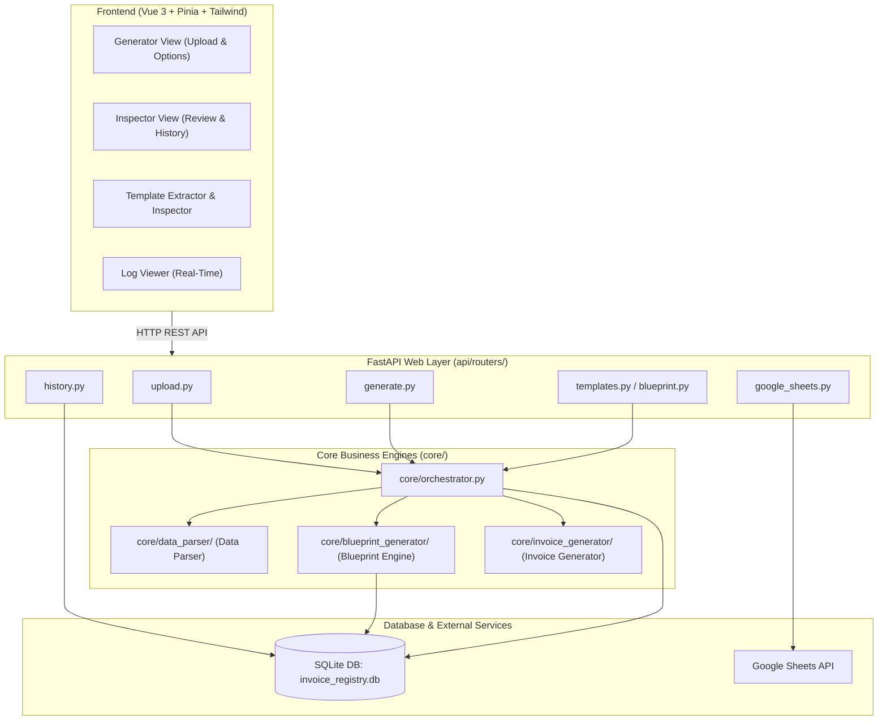

# Vue Invoice System — Codebase Overview & Architecture Guide

## 1. Simple Project Summary (What Problem Does This App Solve?)

In logistics and freight workflows, suppliers and factories submit shipping and packing lists in messy Excel spreadsheets with varying layouts, column headers, and data formats.

### Core Problems:
- Manual copy-pasting into customer invoice templates is time-consuming and error-prone.
- Risk of calculation mistakes (incorrect pricing, broken Excel formulas, inaccurate pallet counts).

### The Solution:
An automated, end-to-end invoice processing and generation pipeline:
1. **Upload & Parse**: Ingests raw Excel files and auto-maps column synonyms (e.g. `GW`, `Gross Wt` -> `gross_weight`) while computing CBM volume, gross/net weight, and pallet count.
2. **Blueprint Matching**: Resolves matching customer invoice layouts, header coordinates, and dynamic formula rules.
3. **Dynamic Invoice Generation**: Injects data rows, shifts Excel formulas down automatically, preserves borders, fonts, and print areas, and outputs finished `.xlsx` / `.zip` files.
4. **Audit & Registry**: Persists line-item records in SQLite for audit history, CSV export, and Google Sheets synchronization.

---

## 2. Directory Structure

```text
vue_invoice_project/
├── api/                           # FastAPI backend web service
│   ├── main.py                    # Entry point: starts server, mounts /frontend static files
│   └── routers/                   # HTTP endpoints by feature
│       ├── upload.py              # File upload & source directory picker
│       ├── generate.py            # Invoice generation (Standard, Custom, DAF modes)
│       ├── blueprint.py           # Template scanner & layout JSON generator
│       ├── templates.py           # Template list, cell preview & override settings
│       ├── history.py             # Run history, registry check/accept/reject
│       ├── logs.py                # Live backend log viewing & clearing
│       └── google_sheets.py       # Google Sheets sync & ref lookup
├── core/                          # Business logic & processing engines
│   ├── orchestrator.py            # Central bridge connecting parser, blueprint & generator
│   ├── logger_config.py           # Central logging setup with request tracing
│   ├── system_config.py           # System paths & .env loader
│   ├── data_parser/               # ENGINE 1: Reads messy Excel, validates & cleans data
│   │   ├── main.py                # Parser entry point (outputs clean JSON)
│   │   ├── sheet_parser.py        # Reads sheets, detects header rows & tables
│   │   ├── validation.py          # Validates columns, datatypes & required fields
│   │   └── data_processor/        # Computes CBM, Gross/Net Weight, Pallet counts
│   ├── blueprint_generator/       # ENGINE 2: Analyzes customer Excel templates
│   │   ├── generator.py           # Scans templates to learn headers, footers & layout rules
│   │   └── schema.py              # Data models for Blueprint layout JSON
│   ├── invoice_generator/         # ENGINE 3: Writes data into final Excel invoices
│   │   ├── generate_invoice.py    # Main generator: applies data, formulas & styles
│   │   ├── builders/              # Sheet builders & row inserters
│   │   ├── styling/               # Preserves fonts, borders, alignments & print areas
│   │   └── mappers/               # Maps parsed data fields to template cells
│   ├── database/                  # SQLite + SQLAlchemy 2.0 layer
│   │   ├── session.py             # DB connection pool with WAL mode & busy timeout
│   │   ├── db_manager.py          # DB facade & table initialization
│   │   ├── models/                # Models (blueprints, invoices, global mappings)
│   │   └── repositories/          # CRUD queries & repository helpers
│   ├── models/                    # Pydantic schemas shared across engines
│   ├── services/                  # Blueprint & Mapping business logic services
│   └── utils/                     # Cache, file lock, timer, ICT (UTC+7) clock utils
├── frontend/                      # User interface (Runs directly in browser)
│   ├── index.html                 # Single page app entry point with ESM importmap
│   ├── css/                       # Tailwind CSS stylesheet
│   └── js/                        # Vue 3 application source
│       ├── app.js                 # Main Vue app shell & tab routing
│       ├── views/                 # Views (Generator, Inspector, Templates, Logs)
│       ├── stores/                # Pinia state stores (generator, inspector, blueprint)
│       ├── components/            # Reusable UI components
│       └── utils/truck.js         # Truck/container capacity math (2T, 5T, 8T, 10T, 15T, 20GP, 40HC)
├── database/                      # SQLite file (invoice_registry.db) & blueprints storage
├── scripts/                       # Maintenance CLI scripts
├── tests/                         # Pytest test suite
└── requirements.txt               # Backend dependencies
```

---

## 3. How Core Components Work Together

```
[ Step 1: Upload ] ──▶ [ Step 2: Parse ] ──▶ [ Step 3: Match Blueprint ]
                                                           │
[ Step 6: DB Save ] ◀── [ Step 5: Review/Accept ] ◀── [ Step 4: Generate ]
```

| Step | Layer | Action |
| :--- | :--- | :--- |
| **1. Upload** | `frontend/js/views/Generator.js` -> `api/routers/upload.py` | User uploads raw packing list Excel. API saves file temporarily. |
| **2. Parse** | `core/data_parser/main.py` | Reads rows, maps column synonyms via DB rules, calculates CBM/Pallets, outputs clean JSON. |
| **3. Match Blueprint** | `core/blueprint_generator/generator.py` | Matches customer code & locale (KH/VN), loads template layout and formula rules from database. |
| **4. Generate** | `core/invoice_generator/generate_invoice.py` | Injects rows, shifts formula ranges down, preserves borders/styles, builds final `.xlsx` / `.zip`. |
| **5. Review** | `frontend/js/views/Inspector.js` | Displays line items, totals, validation warnings, and truck load recommendation. |
| **6. DB Save** | `core/database/session.py` | When user clicks "Accept", records persist into `processed_data` and `invoice_items` tables; optional sync to Google Sheets. |

---

## 4. Architecture Diagram



---

## 5. Core Subsystem Breakdown

### A. Frontend (`frontend/`)
- **Zero-Bundler ESM**: Runs native ES Modules directly in the browser via `<script type="importmap">`. No build/compile step is required.
- **Pinia Stores**: Reactive state management (`generatorStore.js`, `inspectorStore.js`, `templateExtractorStore.js`, `templateInspectorStore.js`).
- **Truck Logic (`truck.js`)**: Real-time vehicle packing calculation (2T, 5T, 8T, 10T, 15T, 20GP, 40HC) from weight, volume, and pallet numbers.

### B. API Layer (`api/`)
- **FastAPI Framework**: Async route handlers and Pydantic schema validation.
- **Routers**:
  - `upload.py`: File upload, folder browsing.
  - `generate.py`: Generate standard/custom/DAF invoices with pricing overrides.
  - `blueprint.py` / `templates.py`: Scan template structure, configure cell formulas.
  - `history.py`: Invoice registry list, accept, reject, and CSV export.
  - `google_sheets.py`: Check duplicate ref numbers and sync rows to Google Sheets.

### C. Backend Core Engines (`core/`)
- **Data Parser (`core/data_parser/`)**: Reads input Excel, normalizes column names, checks tare/CBM warnings, creates intermediate JSON.
- **Blueprint Generator (`core/blueprint_generator/`)**: Analyzes customer templates, learns dynamic cell coordinates.
- **Invoice Generator (`core/invoice_generator/`)**: Fills data rows into Excel template, shifts formula ranges down, preserves cell styling and print boundaries.
- **Orchestrator (`core/orchestrator.py`)**: Runs parser, blueprint, and generator in-process without process-spawning overhead.

### D. Database Layer (`core/database/` & `database/`)
- **SQLite Engine**: Handled via SQLAlchemy 2.0 with WAL mode and 5000ms busy timeout.
- **Tables**:
  - `blueprints` & `blueprint_templates`: Stores customer templates, JSON configs, and raw `.xlsx` binaries.
  - `processed_data` & `invoice_items`: Stores processed invoices, summaries, and individual line items.
  - `global_map_*` (6 tables): Dictionary for recognizing column names and headers automatically.
  - `system_settings`: Application config key-value store.
